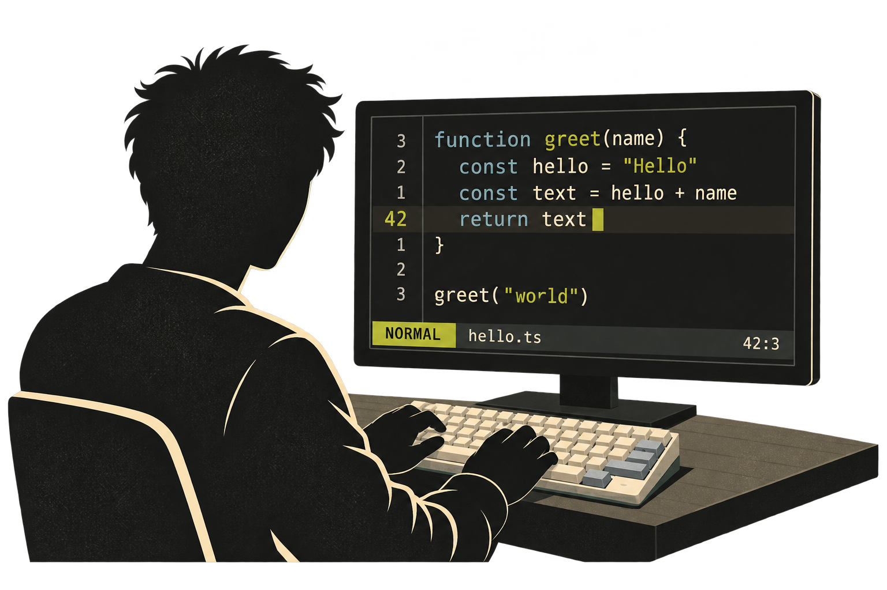
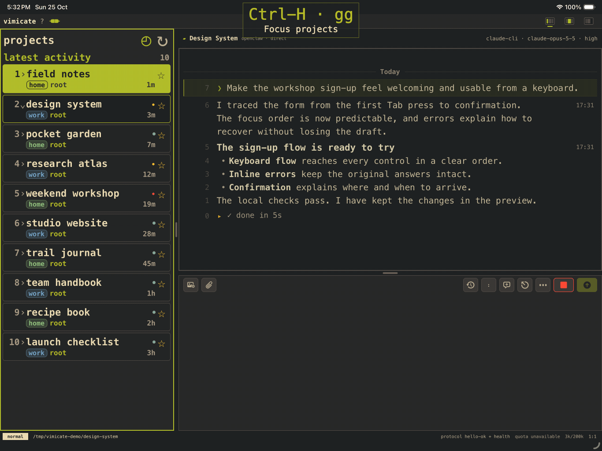
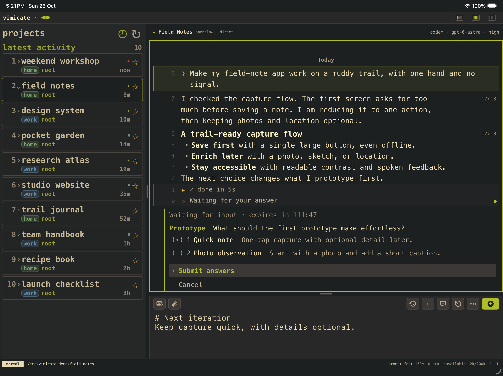
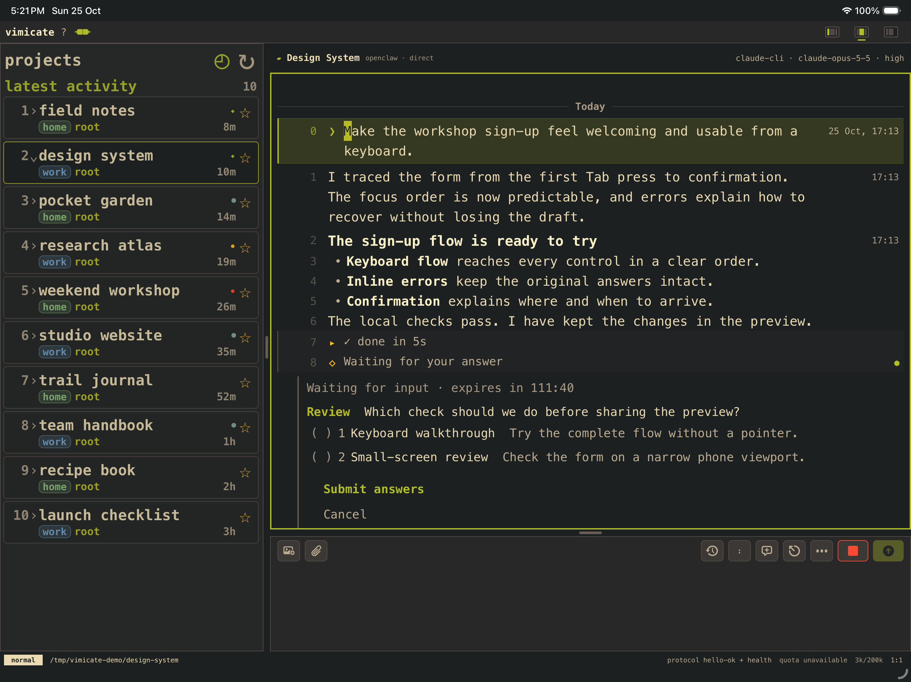
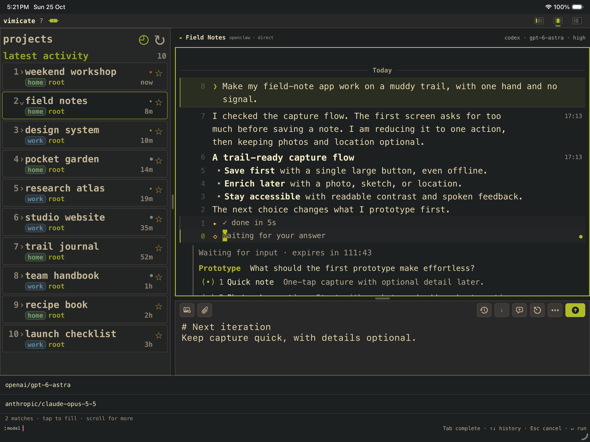
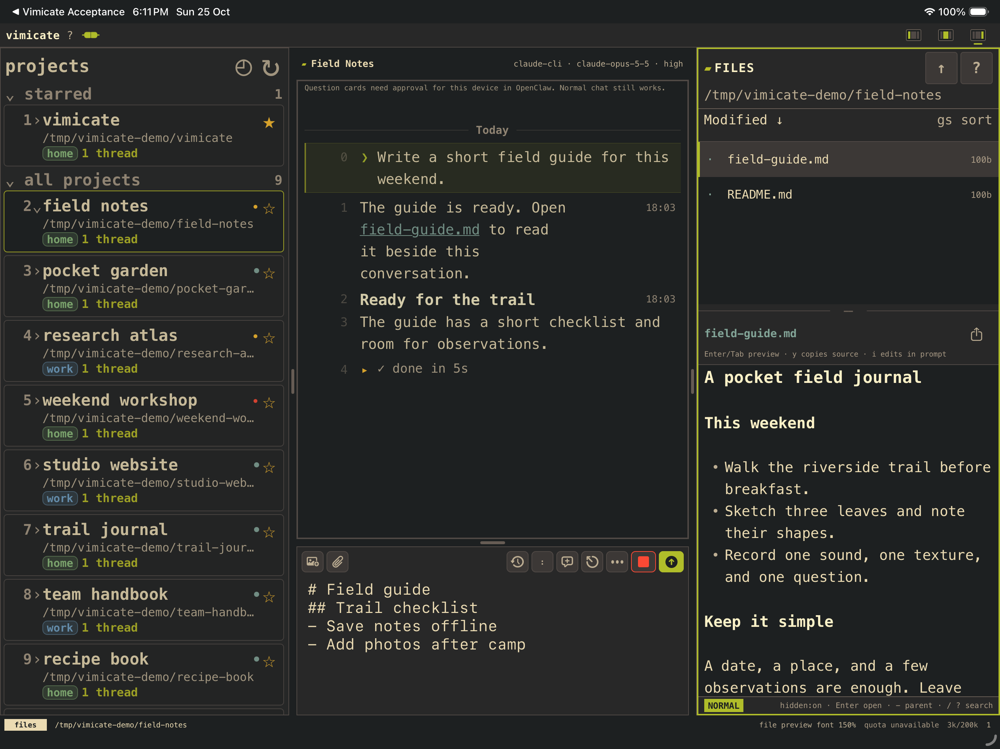
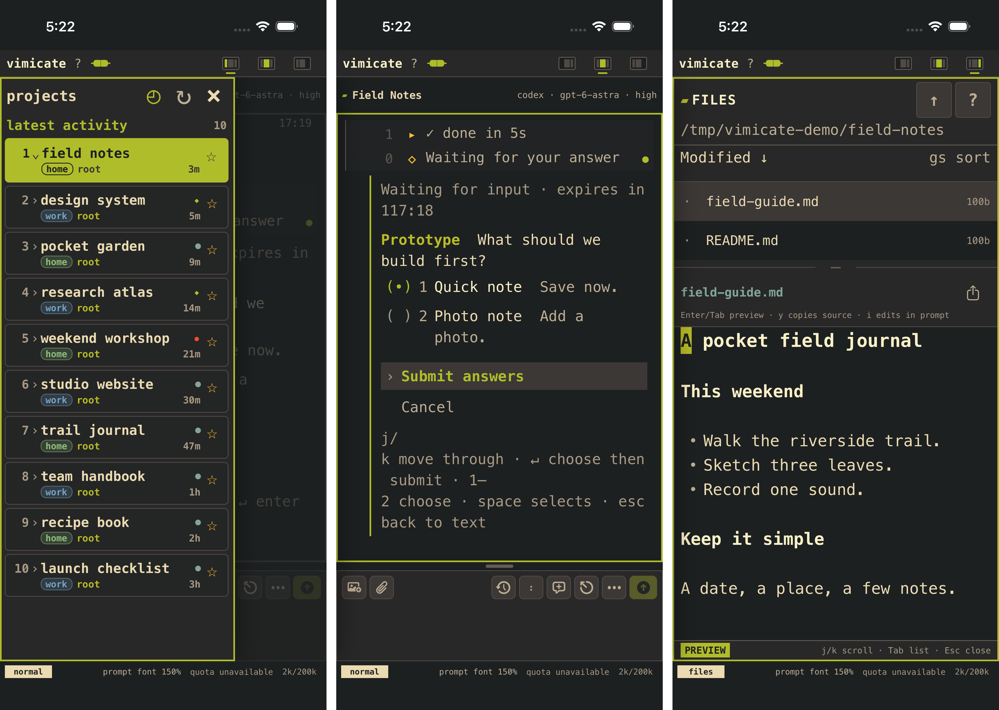
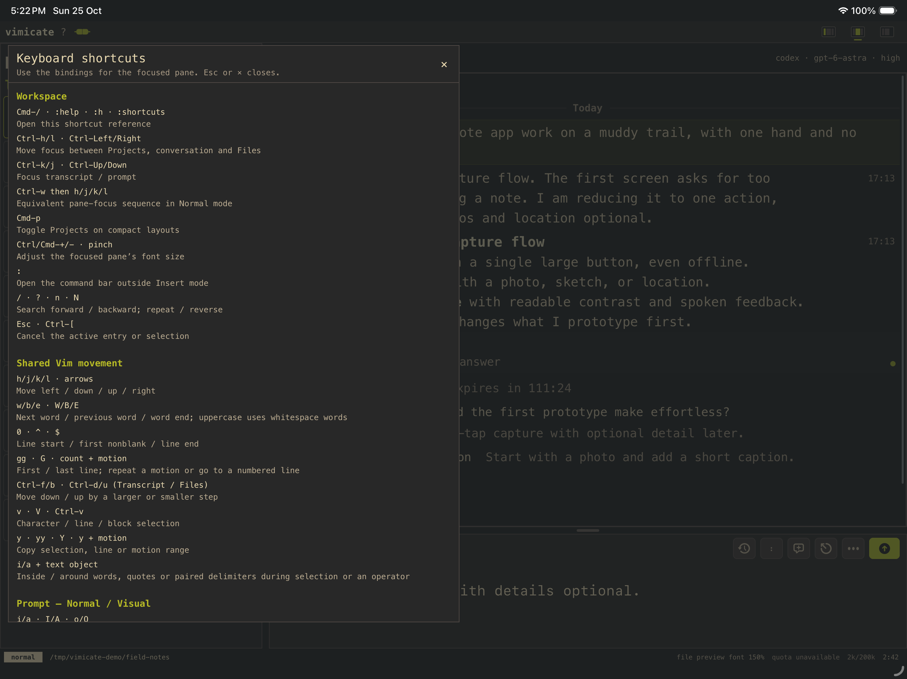
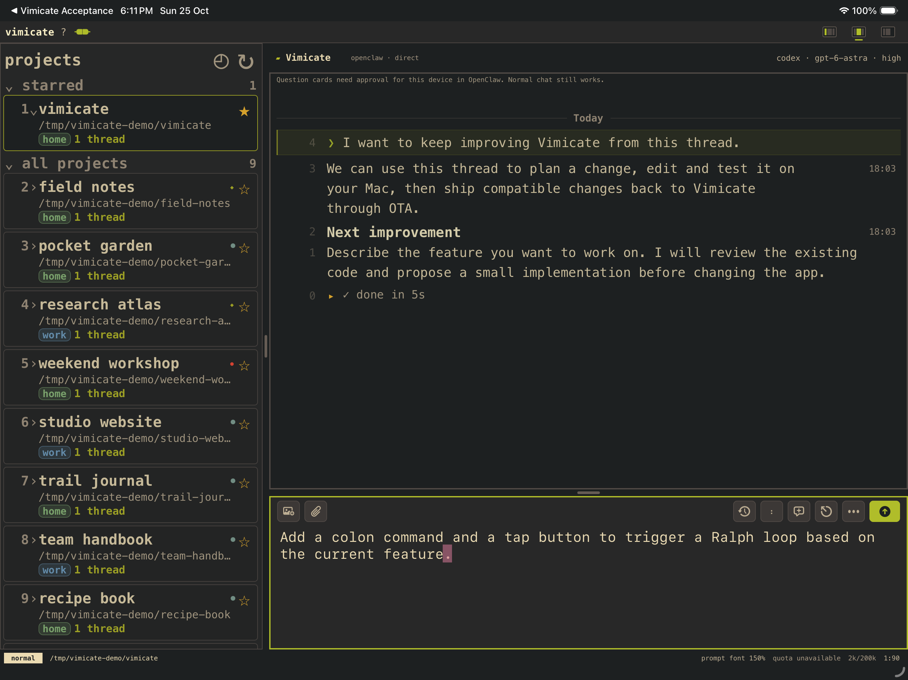

# Vimicate

Vimicate is a keyboard-first iPad and iPhone client for your own OpenClaw
Gateway. It brings prompts, transcripts, project files and interactive agent
questions into one workspace. Native Vim-style editing and pane navigation are
designed for a hardware keyboard, with touch controls alongside them.

Vimicate is a client, not an agent harness or hosted AI service. Your Gateway
owns sessions, model access and tool execution. Pairing establishes device trust.
The app communicates with the Gateway over WebSocket RPC and streamed events.

## Why Vimicate exists

**I’m using my editor less. I don’t want to use Vim less.**

I’ve been a Vim and Neovim user for years, and I enjoy using mechanical keyboards.
I enjoy figuring out how to move through documents without reaching
for the mouse, even if I’m still not particularly good at it.
**Vim makes knowledge work feel like a game**, with motions to learn, secret key
combos to discover, and generally skills to keep honing.

<p align="center">
  
</p>

As more of my work shifts to agents, I open Neovim less often. Most of my
interaction with my computer now happens through an agent connected to a remote
desktop, usually from my iPad. I love the iPad for touch and handwriting. But
when I’m working with an agent, I don’t want to touch the screen at all.

<p align="center">
  
</p>

That’s the **slightly ridiculous combination behind Vimicate**. I wanted an agent
app that felt native to Vim motions and a hardware keyboard, on a device famous
for its touchscreen. I couldn’t find what I wanted, so here we are.

<p align="center">
  
</p>

The name reflects that ambition. If agents increasingly help me operate my
digital life, Vimicate lets me bring Vim’s way of interacting along for the ride,
beyond the editor.

Ultimately, **Vimicate is a software expression of everything I enjoy about
using a computer**, bringing together the feel of a mechanical keyboard, the
playfulness of Vim, the versatility of an iPad, and the possibilities of working
with agents.

## A look inside

A keyboard-first workspace on iPad, with touch-friendly layouts on iPhone.

### Move through the workspace with Vim

Jump between projects, transcript and prompt without reaching for the screen.
Search for a project by name with `/`, then use familiar motions to move by
word or line. Yank a Markdown section from the transcript and paste it into
your prompt. Edit its headings and checklist without leaving the keyboard. The keys appear above the workspace as the demo
moves through each pane.

<p align="center">
  
</p>

Keep home and work projects together, ordered by latest activity. Project
indicators distinguish running sessions, failures and unread updates.
[View the workspace still.](docs/public/readme/workspace-ten-projects-v8.png)

### Make decisions in the conversation

Read progress updates and answer an agent's question without leaving the
transcript. This planning session shows Codex with Astra and high
reasoning effort in the status bar.

<p align="center">
  
</p>

### Follow work across backends

Keep the same workspace when a project uses a different backend. This second
session shows claude-cli with Opus 5.5 and a different conversation.

<p align="center">
  
</p>

### Use colon commands

Type `:model` to switch models without leaving the conversation. The completion
menu shows matching options from the connected backend's model catalogue.

<p align="center">
  
</p>

### Keep files beside the conversation

Browse project files and preview Markdown without leaving the workspace.

<p align="center">
  
</p>

### Take the workspace to iPhone

The same workspace adapts to a smaller screen. Open the project drawer to
check activity, answer a question in the conversation, or browse files and
read a Markdown preview.

<p align="center">
  
</p>

### Learn the default bindings first

**Click the question mark (`?`) at the top left before you start.** The built-in
reference explains the default bindings for navigation, editing and each pane.

<p align="center">
  
</p>

## Built to customize

Vimicate is built primarily with **React Native and TypeScript, using Expo**.
SQLite stores local data, SecureStore/Keychain holds credentials, and OpenClaw
provides the agent backend. A small set of native Swift/Expo modules handles
platform integration such as hardware-keyboard input and file previews.

I chose OpenClaw for its vibrant community, openness, configurability, and
freedom to work across labs and models.

React Native is a good fit because most everyday changes are to the interface,
Vim interactions and agent workflows, rather than new native capabilities.
Those changes usually need no native code changes and can reach an existing,
compatible installation through [Expo over-the-air updates](https://docs.expo.dev/eas-update/introduction/).
Changes to native modules, native dependencies or permissions still require
a new iOS build.

### Developing Vimicate from Vimicate

I often use a Vimicate development thread **inside Vimicate itself** to improve
the app. I describe a change in that thread, the agent edits and tests the code
on my connected Mac, and I review the result. It then publishes a compatible
OTA update, which I load back into the same app. That lets me keep customizing
my workspace while using it.

<p align="center">
  
</p>

To adopt this loop, configure your own update project and channel and install
a compatible native build. The public contributor configuration deliberately
[disables OTA by default](docs/CONTRIBUTOR_SETUP.md#build-the-contributor-app)
and does not subscribe to my private releases.

### Who this is for

Vimicate currently works best for people comfortable developing apps and
understanding this self-development workflow on iOS. You should be happy to
build and sign your own app, review agent-written changes, distinguish OTA
updates from native builds, and keep tailoring Vimicate to your own needs.

**[Artifactured](https://www.artifactured.com) is considering offering Vimicate
as a ready-to-install iOS app if there is enough demand.**

## Development transparency

Vimicate is an agentically developed app. AI coding agents contribute
substantially to implementation, tests, documentation, and review, under my
direction. I set the product goals and remain responsible for what I release.

This began as a tool for my own use and is shared in the spirit of open source.
Automated tests and agent reviews do not guarantee correctness or security.
It is experimental software, provided as-is. Review the code and
[known limitations](docs/KNOWN_LIMITATIONS.md), and test it in your own
environment before relying on it.

## How it fits together

```text
      BACKEND                      ORCHESTRATION                       SURFACE

+------------------+  JSON-RPC over stdio
| Codex app-server |--------------------+
+------------------+                    |
                                        |
+------------------+              +-----+------+                    +------------+
| Claude CLI (-p)  |--------------|  OpenClaw  |--------------------|  Vimicate  |
+------------------+ stream-JSON  |  Gateway   |  WebSocket RPC     +------------+
                     over stdio   +-----+------+  + streamed events
                                        |         (paired device)
+------------------+                    |
|    Pi harness    |--------------------+
+------------------+  function calls/events
                      (in-process library)
```

The lines represent two-way communication. Pairing establishes device trust,
while WebSocket carries ongoing requests and events. Pi runs as a library inside
OpenClaw’s process. Vimicate is the client, not another agent harness.

## Source alpha

This is an experimental source-only alpha for contributors. It is not a signed
app download, an App Store release or a supported production deployment.
Build, host-integration and device checks cover different boundaries. Read the
[known limitations](docs/KNOWN_LIMITATIONS.md) before using it.

The source includes the React Native application, narrow native Expo modules,
host integration, synthetic tests and required assets. It does not include model
subscriptions, signing credentials, private conversations or the maintainer's
original development history.

## Set up Vimicate

You need an OpenClaw Gateway with your own model access, plus a native Vimicate
build. This source alpha does not include an App Store or TestFlight download.

### 1. Prepare OpenClaw on your host computer

Read the official [OpenClaw getting-started guide](https://docs.openclaw.ai/start/getting-started)
for installation, provider sign-in, and Gateway onboarding. Vimicate connects
to that Gateway rather than directly to a model provider.

For this alpha, follow our [isolated host setup](docs/CONTRIBUTOR_SETUP.md#prepare-an-independent-stock-host)
for the exact installation commands and Vimicate host integration. That recipe
targets `openclaw@2026.10.6` with audited runtime fingerprints. A newer version
is not automatically compatible. It prepares separate state, applies the host
integration, and runs a local Gateway without changing an existing installation.

### 2. Build the contributor app on a Mac

Install Xcode, Node.js, pnpm, and CocoaPods using the tested versions in the
[contributor guide](docs/CONTRIBUTOR_SETUP.md#toolchain). Then run

```sh
git clone https://github.com/chektien/vimicate.git
cd vimicate/apps/mobile
pnpm install --frozen-lockfile
pnpm config:contributor
pnpm prebuild:contributor
pnpm ios:contributor --device
```

Choose an iOS simulator in the device selector for the initial setup. Expo Go
cannot load Vimicate’s native modules. The simulator path needs no Apple signing
account. Installing on your own iPad or iPhone requires your own development
signing and a unique bundle identifier, as described in the contributor guide.

### 3. Pair Vimicate with your Gateway

With the isolated Gateway running, use the same host environment from step 1
to generate a setup code

```sh
node "$CONTRIBUTOR_OPENCLAW_BIN" qr --url ws://127.0.0.1:19091 --no-ascii
```

Paste the setup code into Vimicate’s Gateway connection field and approve the
device on your host when prompted. This loopback address works only for a
simulator on the same Mac. An iPad or iPhone needs an authenticated Gateway
endpoint reachable from that device, not `127.0.0.1`.

Follow the [pairing and interaction checks](docs/CONTRIBUTOR_SETUP.md#pair-and-check-a-complete-interaction)
to send a first prompt, create a thread, answer a structured question, and verify
reconnection. Keep setup codes and credentials private.

### 4. Learn the default bindings

**Before you start, click the question mark (`?`) at the top left of the app.**
It opens the Vim and keyboard shortcut reference. Read through the default
bindings to understand how to navigate the workspace and edit prompts. This is
the essential first stop for learning how to use Vimicate with your keyboard.

## Build and contribute

Start with [contributor setup](docs/CONTRIBUTOR_SETUP.md), then read
[contribution guidance](CONTRIBUTING.md). Native iOS development requires macOS
and Xcode. Expo Go cannot load the local native modules.

The application uses Expo SDK 57, React Native 0.86 and React 19.2.3. Install
dependencies with the committed pnpm lockfile and patches.

```sh
cd apps/mobile
pnpm install --frozen-lockfile
pnpm typecheck
pnpm test:public
```

Run portable host tests from the repository root.

```sh
node --test host/openclaw/*.test.mjs
```

Installed-runtime acceptance tests identify their required OpenClaw package
explicitly. A skipped runtime test is not evidence that a host installation works.

## Source layout

- `apps/mobile/src` contains application owners, presentation and tests.
- `apps/mobile/modules` contains narrow native platform bridges.
- `host/openclaw` contains the separately installed Gateway integration.
- `docs` contains setup and architecture documentation.

## License and notices

Original project code is available under the [MIT license](LICENSE), copyright
2026 Chek Tien Tan. Existing upstream notices remain in place.
[Third-party notices](THIRD_PARTY_NOTICES.md) and
[asset provenance](docs/release/ASSET_PROVENANCE.json) identify retained material.
Dependency licenses still apply when building or distributing compiled artifacts.
